# Fainext Client Portal

A front-end demo of a client portal for **Fainext**, a Rwandan financial services
company. It covers the full client journey — registration, login, a dashboard with
balances and spending, and a searchable, filterable, exportable transaction history.

Built with **plain HTML, CSS and vanilla JavaScript only**: no frameworks, no npm,
no build step, no CDNs. Every page runs by double-clicking `index.html` and works
unchanged on GitHub Pages.

---

## Features

**Authentication**
- Registration with full name, email, Rwandan phone number, password and terms
- Live password strength bar (weak / medium / strong)
- Passwords hashed with the Web Crypto API (SHA-256) before being stored
- Login with email + password, "Remember me" and a Show/Hide password toggle
- Per-field validation with red inline error messages
- Duplicate-email check on registration
- Protected pages: the dashboard and transactions redirect to login without a session

**Dashboard**
- Time-aware greeting ("Good morning / afternoon / evening, [first name]") and today's date
- Four summary cards: Total Balance, Money In (this month), Money Out (this month),
  Total Transactions — all in Rwandan Francs, formatted `RWF 1,250,000`
- Six-month spending bar chart built from plain HTML/CSS `div`s — no chart library
- **"What this means"** — plain-language insights generated from the data: biggest
  spending category, month-on-month change, money still pending, failed payments
  worth retrying, and the month's savings rate
- **"Where your money goes"** — spending for the last 30 days broken down by
  category, as horizontal bars with each category's share of the total
- **Savings goals** — create a goal with a target and a date, add contributions,
  watch the progress bar fill, delete a goal when it is done. Stored per account
- Recent Activity table: the 5 latest transactions with colour-coded amounts and
  status badges (Completed / Pending / Failed)
- Quick Actions panel: Send Money, Pay Bill, and a working **Download Statement**

**Transactions**
- Full table: Date, Reference, Description, Type, Category, Method, Amount, Status
- Payment methods: MTN MoMo, Airtel Money, Bank Transfer, Card
- Six filters that all work together and update instantly: search (description,
  reference or category), type, status, **category**, date from, date to
- **Totals for the current filter** — money in, money out and net, recalculated
  every time a filter changes
- Live "Showing X of Y transactions" counter and a "No transactions found" empty state
- **Export CSV** — downloads exactly the rows currently visible
- **Print / PDF** — the same rows as a clean statement through the browser's own
  print dialog

**Across the app**
- **Automatic categorisation** — every transaction is tagged from its description
  (Housing & Rent, Utilities & Bills, Groceries & Shopping, Transport, Health,
  Education, Savings & Contributions, Transfers & Cash, Income, Other). Nothing to
  tag by hand
- **Transaction detail dialog** — select any table row, on either page, to see the
  full record. Opens on click or Enter/Space, closes on Escape or a backdrop click,
  and returns focus to the row it came from
- **Dark mode** — a navbar toggle that follows the operating system setting by
  default and remembers the choice. Set before the first paint, so no white flash
- **Printable statement** — account holder, closing balance, month totals and the
  last 20 transactions, laid out for A4 by a `@media print` stylesheet

**Design**
- Primary `#0b5394`, accent `#f4b400`, light grey background `#f4f6f9`
- Every colour is a CSS custom property, which is what makes the dark theme a short
  list of token overrides rather than a second stylesheet
- White cards, soft shadows, rounded corners, system font stack
- Fully responsive: two-column auth pages stack on mobile, cards reflow, tables scroll
- Keyboard-reachable controls, ARIA labels on icon buttons and progress bars, and a
  `prefers-reduced-motion` opt-out for the animations

---

## Tech used

| Layer | Choice |
|---|---|
| Markup | HTML5 |
| Styling | CSS3 (custom properties, Flexbox, Grid, media queries) |
| Logic | Vanilla JavaScript (ES5-compatible syntax, no modules) |
| Storage | `localStorage` |
| Hashing | Web Crypto API — `crypto.subtle.digest("SHA-256", …)` |
| Export | `Blob` + object URL (no library) |
| Statement | `@media print` stylesheet + `window.print()` |
| Theming | CSS custom properties switched by `<html data-theme>` |
| Wireframes | Hand-written SVG |

No dependencies, no package manager, no internet connection required.

---

## How to run

**Locally** — clone or download the folder, then open `index.html` in any modern
browser. That is the whole setup.

```bash
git clone https://github.com/<your-username>/fainext-portal.git
cd fainext-portal
# then open index.html
```

**Live demo (GitHub Pages)**

> https://&lt;your-username&gt;.github.io/fainext-portal/

Replace `<your-username>` once Pages is enabled on the repository.

**First time through:** there are no pre-seeded accounts. Open `register.html`
(or click "Sign up" on the login page), create an account, then sign in with it.
`sample-account.example.json` holds the demo details used for the screenshots if
you would rather not invent your own.

---

## Folder structure

```
fainext-portal/
├── index.html              Login page
├── register.html           Registration page
├── dashboard.html          User dashboard (protected)
├── transactions.html       Transactions page (protected)
├── css/
│   └── style.css           One shared stylesheet
├── js/
│   ├── auth.js             Login, registration, session + page protection
│   ├── data.js             Sample transactions, categories, insights, formatters
│   ├── ui.js               Theme toggle, transaction dialog, printable statement
│   ├── goals.js            Savings goals: create, contribute, delete
│   ├── dashboard.js        Greeting, summary cards, chart, categories, activity
│   └── transactions.js     Filters, totals, table rendering, CSV export
├── wireframes/
│   ├── login.svg           Low-fidelity wireframe (1440 × 900)
│   ├── dashboard.svg       Low-fidelity wireframe (1440 × 900)
│   └── transactions.svg    Low-fidelity wireframe (1440 × 900)
├── screenshots/            Screenshots used in this README
├── fainext-demo.mp4        Silent 3:40 walkthrough recording (12 MB)
├── documentary-script.md   Narration script matched to the recording
└── README.md
```

> `fainext-demo.mp4` is a 12 MB binary. If you would rather keep the repository light,
> add it to `.gitignore` and share the file separately — nothing in the portal depends
> on it.

### Wireframes

The three SVGs in `wireframes/` are greyscale, low-fidelity layouts matching the
real screens. They open directly in a browser and can be dragged straight into
Figma, where each box imports as an editable vector layer.

---

## Screenshots

| Screen | Preview |
|---|---|
| Login | 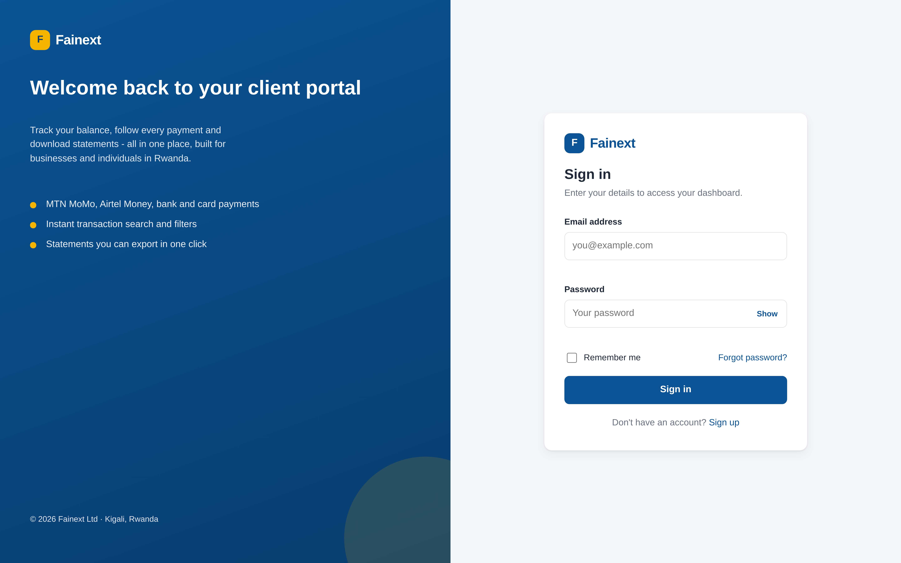 |
| Registration, with validation | 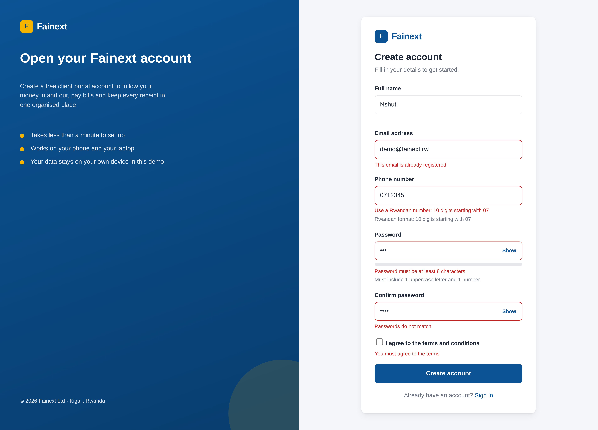 |
| Dashboard | 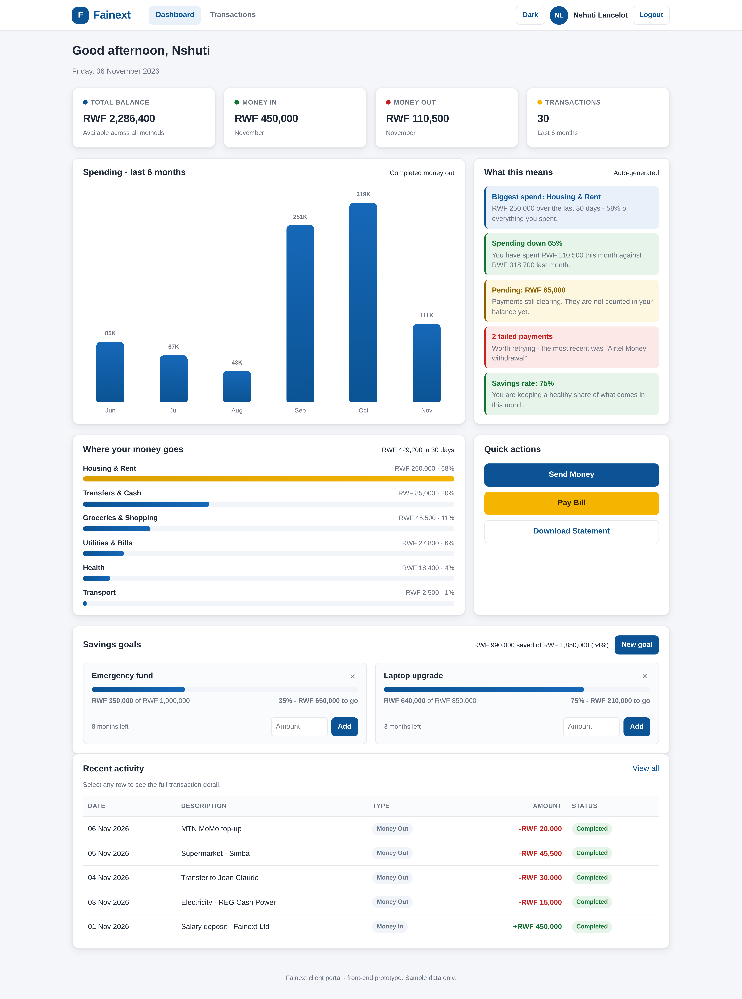 |
| Automatic insights | 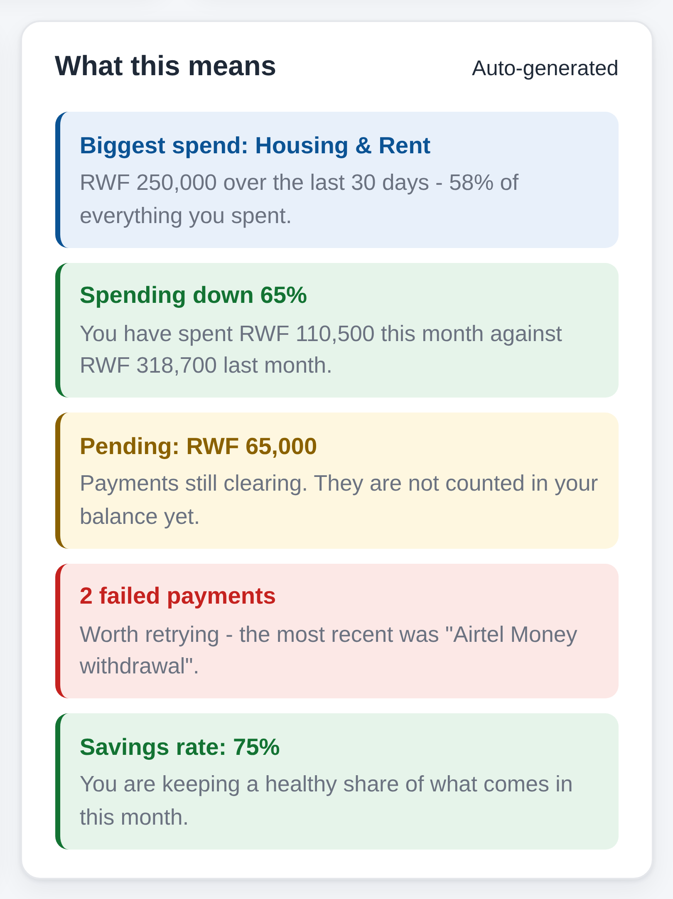 |
| Spending by category | 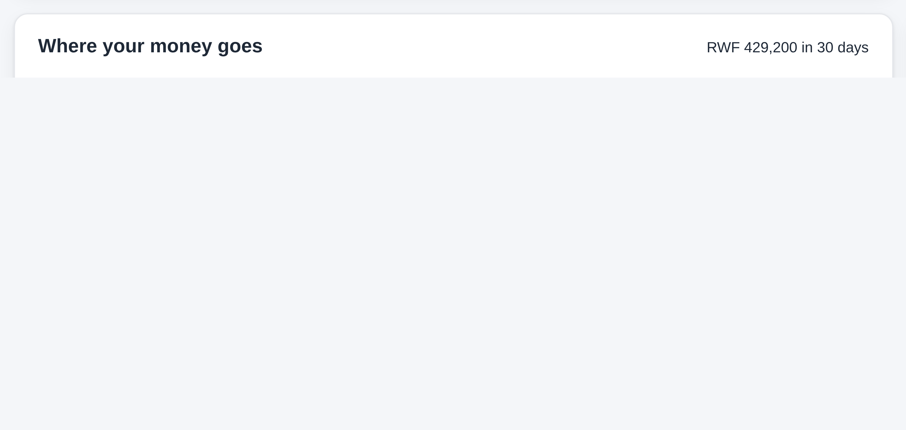 |
| Savings goals | 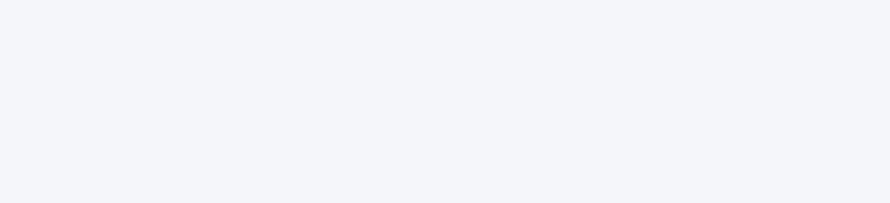 |
| Creating a goal | 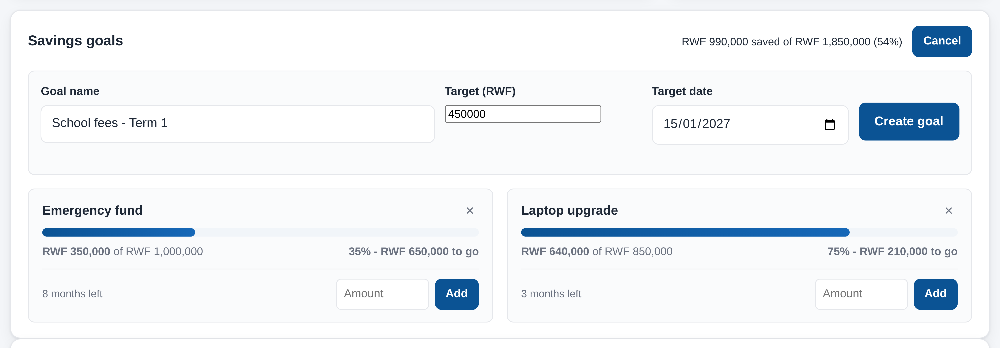 |
| Transaction detail dialog | 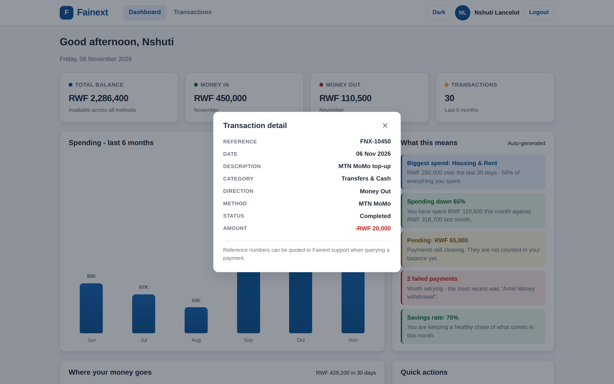 |
| Transactions | 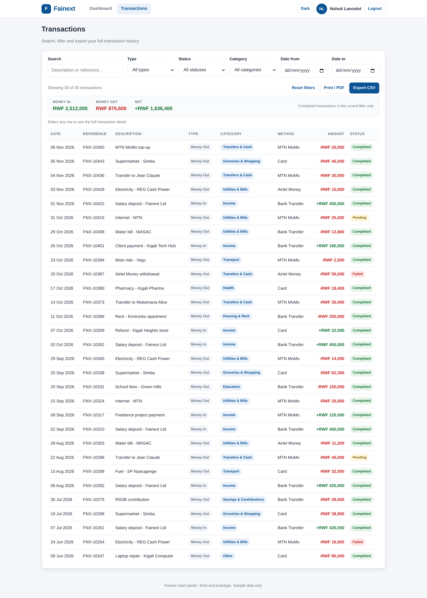 |
| Transactions, filtered by category | 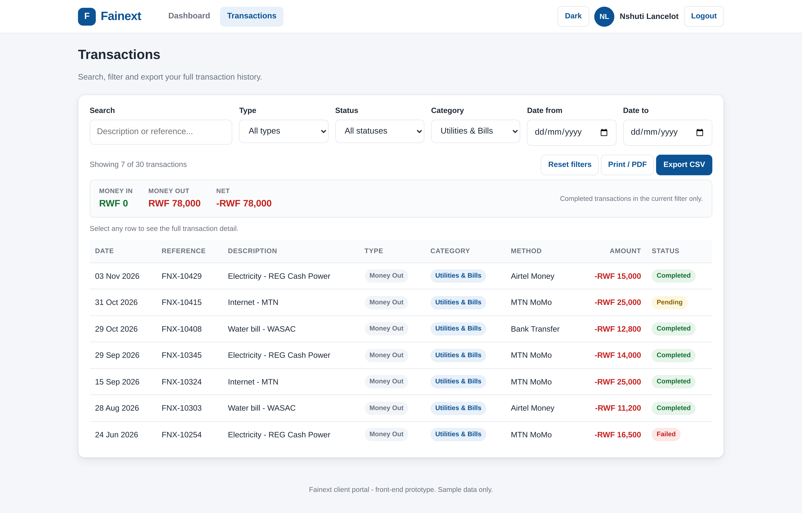 |
| Dashboard in dark mode | 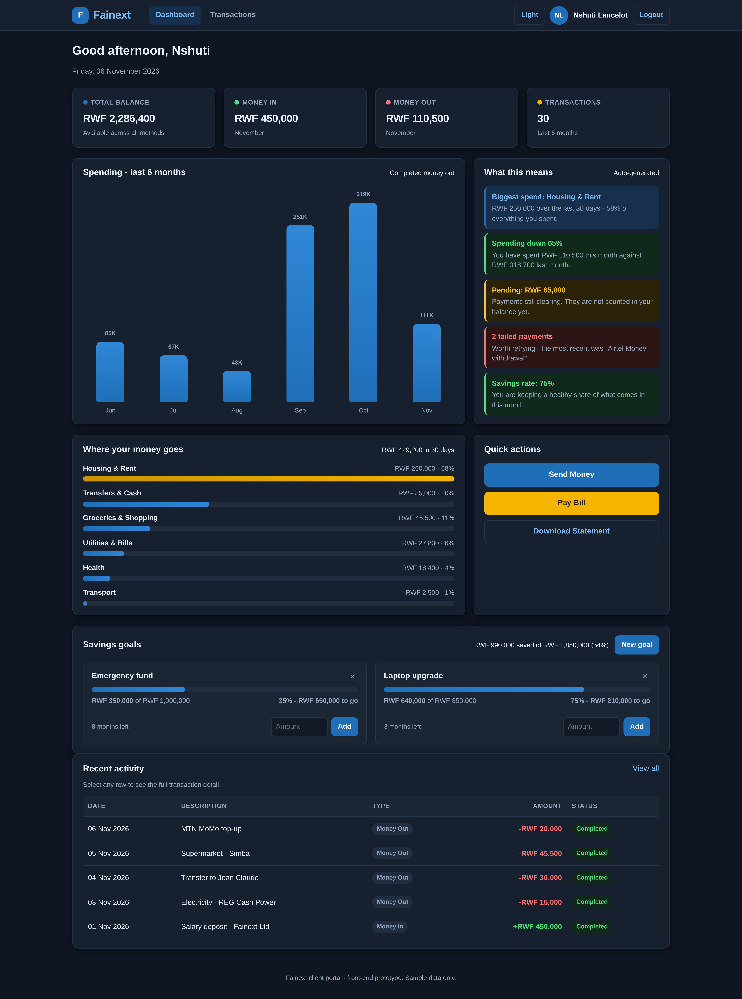 |
| Printable statement | 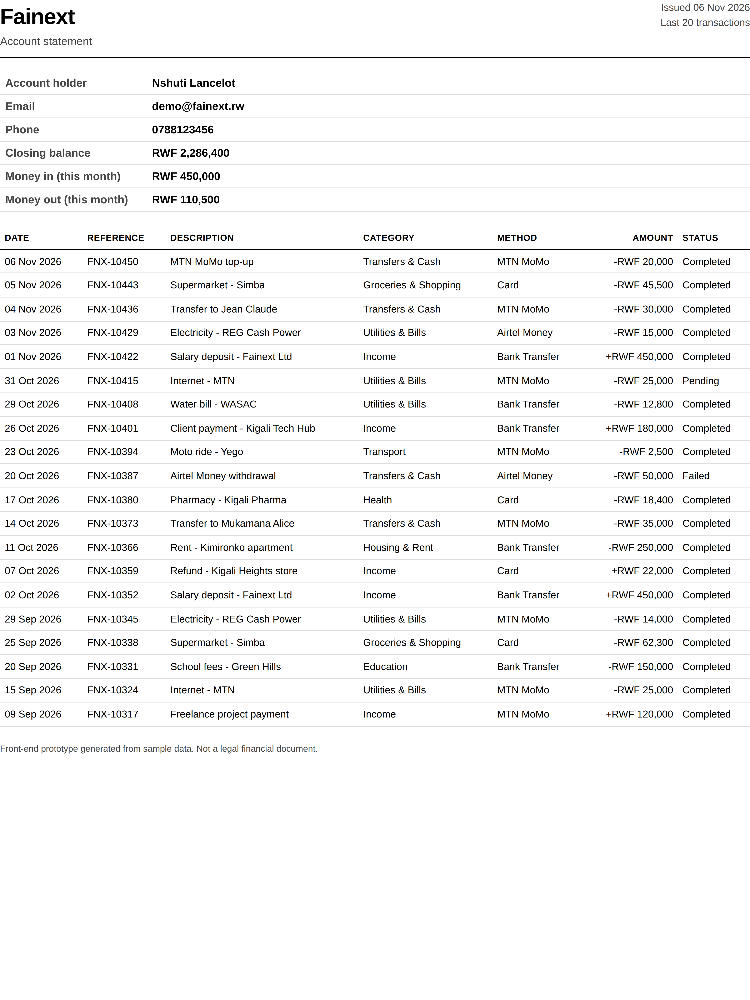 |
| Mobile dashboard |  |

---

## Sample data

`js/data.js` holds 30 realistic transactions with Rwandan context — MTN MoMo
top-ups, REG Cash Power, WASAC water bills, salary deposits, Simba Supermarket,
school fees, RSSB contributions and transfers to named people.

Dates are generated **relative to today**, so the dashboard and the six-month
chart always look current no matter when the project is opened.

---

## Note on authentication

> **This is a front-end prototype.** Accounts live in the browser's `localStorage`
> and never reach a server. SHA-256 hashing is included to demonstrate the pattern,
> but unsalted client-side hashing is **not** real security: anyone with access to
> the browser can read or modify the stored data, and clearing site data deletes
> every account. The transaction data is sample data, not real financial records.
> Do not use this authentication approach in production — a real build needs a
> backend, a proper password hash (bcrypt/argon2) and server-side sessions.

---

## Author

**Nshuti Lancelot**
Software Developer Intern at Fainext
